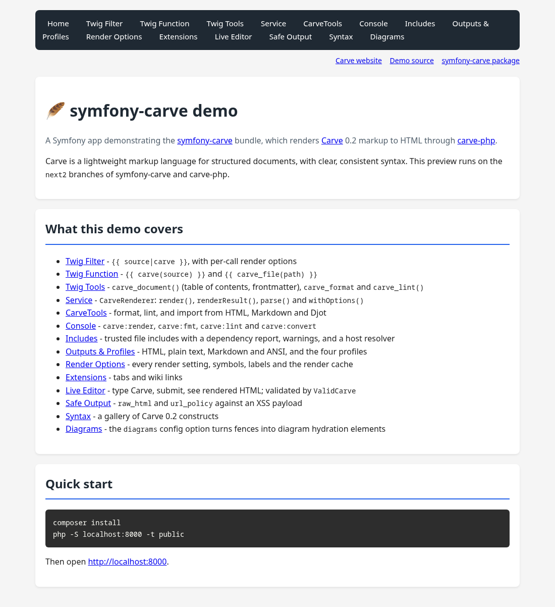
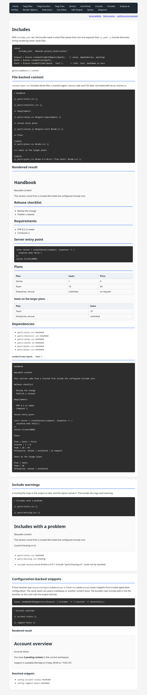
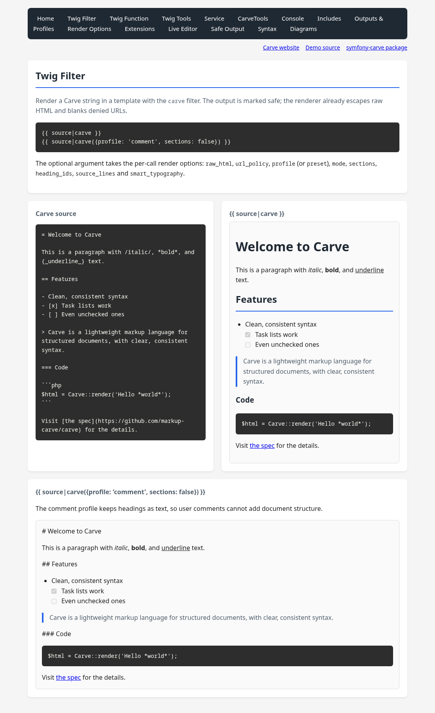
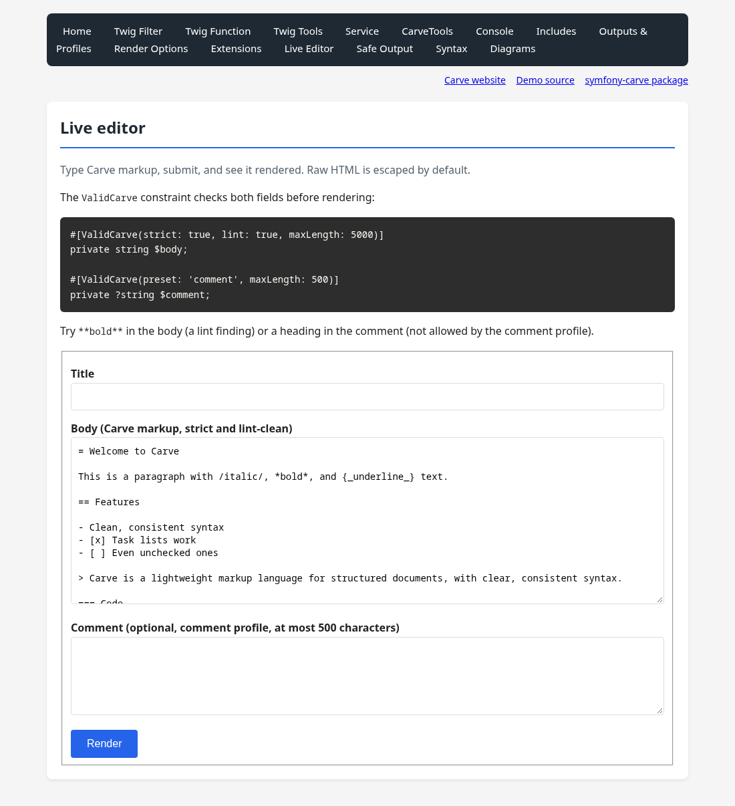
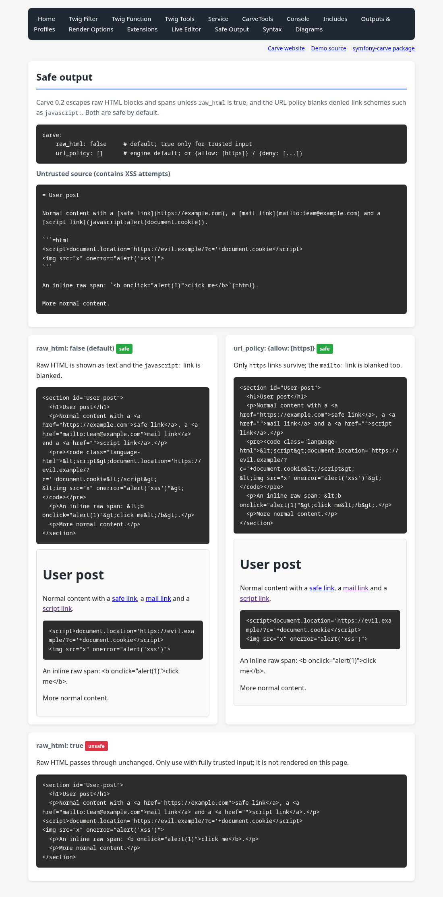
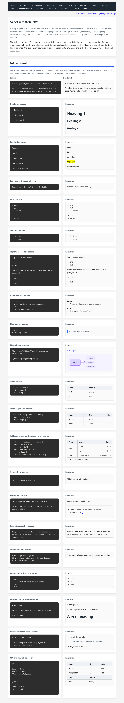
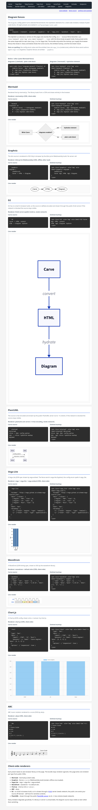

# Screenshots

A visual tour of the symfony-carve demo app. Boot it (`symfony serve` or
`php -S 127.0.0.1:8000 -t public`) and click through the pages in the nav.

## Home

Overview of all demo pages.

## Includes

Trusted file-backed content, include warnings and application-provided
snippets, with each directive's resolved dependency report.

## Twig filter

Carve source and rendered HTML side by side.

## Live editor and safe output

| Live editor | Safe output |
|---|---|
|  |  |

## Syntax gallery

Carve 0.2 constructs (inline literal, braced spans, definition lists,
footnotes, tight vs loose lists, smart typography, escaped block markers,
and blocks inside list items).

## Live Diagram Gallery

All eight fenced-render presets drawn live in the browser - mermaid, plantuml,
graphviz, d2, vega-lite, wavedrom, chart, abc. Each shows the Carve source, the
emitted hydration markup, and the drawn result (the source stays visible if a
renderer fails to load).

